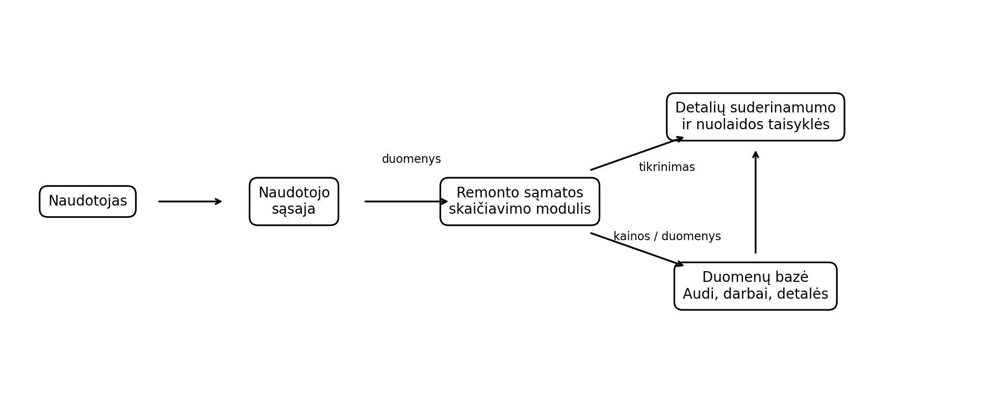

# Audi automobilių serviso remonto darbų skaičiavimo sistema

## Kursinio darbo I dalis: projektavimo dokumentas

## 1. Problema ir idėja

**Sistema vienu sakiniu:** Sistema skirta automobilių serviso darbuotojui arba klientui, kad pagal pasirinktą Audi automobilį, remonto darbus ir reikalingas detales būtų galima apskaičiuoti preliminarią remonto kainą ir darbų trukmę.

**Problema ir dabartinis procesas:** Remonto kaina dažnai apskaičiuojama rankiniu būdu, atskirai įvertinant darbų ir detalių kainas. Pasirinkus daugiau darbų arba detalių, didėja skaičiavimo klaidų tikimybė ir tampa sunkiau greitai suprasti galutinės kainos sudėtį.

**Nauda:** Sistema automatizuos preliminarios sąmatos sudarymą, sumažins rankinio skaičiavimo poreikį ir aiškiai parodys, iš ko susideda galutinė kaina bei numatoma darbų trukmė.

**Naudotojai:** Serviso darbuotojas pasirenka Audi automobilį, darbus ir detales bei sudaro sąmatą. Klientas gali peržiūrėti preliminarią remonto kainą ir jos sudėtį.

**Prielaidos:** Sistemoje naudojami iš anksto įvesti Audi automobilių, detalių ir remonto darbų duomenys. Laikoma, kad detalės yra susietos su Audi automobiliais, kuriems jos tinka. Remonto darbų kainos ir trukmės laikomos preliminariomis. Sistema nepateikia oficialios galutinės serviso sąskaitos, o nuolaidų taisyklės yra nustatomos sistemoje.

## 2. Apimtis

| Funkcija | Ką naudotojas galės atlikti | Pagrindinis modulis ar pagalbinė funkcija |
|---|---|---|
| Audi automobilio pasirinkimas | Pasirinkti sistemoje numatytą Audi automobilį ir kitus jo duomenis. | Pagalbinė funkcija |
| Remonto darbų ir detalių pasirinkimas | Pasirinkti remonto darbus bei reikalingas detales ir patikrinti jų suderinamumą su pasirinktu Audi automobiliu. | Pagalbinė funkcija |
| Remonto sąmatos skaičiavimas | Apskaičiuoti darbų ir detalių kainą, pritaikyti nuolaidą ir pateikti galutinę sąmatą. | **Pagrindinis modulis** |

**Į kursinio darbo apimtį neįeina:** Tikri mokėjimai, atsarginių dalių užsakymas iš tiekėjų, SMS ar el. pašto pranešimai, darbuotojų darbo užmokesčio apskaita, realaus serviso sandėlio valdymas ir integracijos su išorinėmis automobilių dalių sistemomis.

## 3. Pagrindinis modulis

**Pavadinimas ir atsakomybė:** Remonto sąmatos skaičiavimo modulis atsakingas už pasirinkto Audi automobilio duomenų ir remonto pasirinkimų apdorojimą, detalių suderinamumo patikrinimą, kainos bei darbų trukmės apskaičiavimą ir nuolaidos pritaikymą.

**Logika, kurią reikės projektuoti ir testuoti:** Modulis turi patikrinti detalių suderinamumą, apskaičiuoti bendrą darbų ir detalių kainą, taikyti nuolaidos taisyklę ir apskaičiuoti numatomą darbų trukmę.

**Įvestis:** Pasirinktas Audi A4 B7; darbai: alyvos keitimas – 30 €, stabdžių kaladėlių keitimas – 70 €; detalės: alyvos filtras – 15 €, stabdžių kaladėlės – 80 €. Bendra pradinė suma – 195 €.

**Išvestis:** Sistema pateikia kainos išskaidymą, galutinę kainą, pritaikytą nuolaidą, numatomą darbų trukmę ir informaciją apie galimas klaidas.

**Veikimo eiga:** 1) pasirenkamas Audi automobilis; 2) pasirenkami remonto darbai; 3) pasirenkamos detalės; 4) patikrinamas detalių suderinamumas; 5) apskaičiuojama darbų ir detalių kaina; 6) patikrinama nuolaidos sąlyga; 7) apskaičiuojama galutinė kaina ir trukmė; 8) pateikiama sąmata.

### Taisyklės arba sprendimo žingsniai

1. Jei bent viena pasirinkta detalė nėra suderinama su pasirinktu Audi automobiliu, sąmata negali būti patvirtinta.
2. Galutinės kainos pagrindą sudaro visų pasirinktų darbų ir detalių kainų suma.
3. Jei bendra darbų ir detalių suma viršija 300 €, pritaikoma 5 % nuolaida.

### Scenarijai būsimiems testams

| Scenarijus | Pradinės sąlygos ir konkreti įvestis | Veiksmas | Tikslus laukiamas rezultatas |
|---|---|---|---|
| Įprastas atvejis | Audi A4 B7, darbai 100 €, detalės 95 €, visos detalės suderinamos. | Skaičiuoti sąmatą | Rodoma 195 € galutinė kaina, nuolaida netaikoma. |
| Ribinis atvejis arba konfliktas | Audi A4 B7, darbai ir detalės iš viso 301 €, visos detalės suderinamos. | Skaičiuoti sąmatą | Pritaikoma 5 % nuolaida, galutinė suma – 285,95 €. |
| Klaida arba neįmanomas rezultatas | Audi A4 B7 ir detalė, kuri su šiuo automobiliu nesuderinama. | Skaičiuoti sąmatą | Sistema nepatvirtina sąmatos ir parodo, kuri detalė netinkama. |

**Jei modulis naudoja AI:** Netaikoma. Pagrindinis sistemos skaičiavimo modulis AI nenaudos, nes kainos, suderinamumo ir nuolaidų taisyklės turi būti deterministinės ir patikrinamos.

## 4. Kokybės atributas

**Pasirinktas atributas:** Palaikomumas (moduliškumas).

**Kodėl svarbus šiai sistemai:** Serviso kainos ir nuolaidų taisyklės gali keistis, todėl sistema turėtų leisti jas keisti neperrašant viso pagrindinio modulio.

**Tikrinimo scenarijus ir sąlygos:** Pridedama nauja nuolaidos taisyklė, nekeičiant kainos skaičiavimo ir detalių suderinamumo logikos.

**Sėkmės kriterijus:** Pridėjus naują taisyklę ankstesni kainos skaičiavimo ir suderinamumo testai lieka sėkmingi, o nauja taisyklė veikia pagal nustatytą sąlygą.

**Numatytas projektavimo sprendimas:** Kainos skaičiavimą, suderinamumo tikrinimą ir nuolaidų taikymą atskirti į atskiras programos dalis.

**Kaip patikrinsiu vėlesniame etape:** Atliksiu vienetinius testus ir pakeitimo scenarijų, kuriame bus pridėta nauja nuolaidos taisyklė.

**Sprendimo kaina arba ribojimas:** Modulinė struktūra pareikalaus daugiau pradinių klasių, metodų ir testų nei vienas paprastas skaičiavimo metodas.

## 5. Pradinė sistemos struktūra

### Paprasta schema

| Sistemos dalis | Atsakomybė |
|---|---|
| Naudotojo sąsaja | Priima Audi automobilio, darbų ir detalių pasirinkimus bei parodo sąmatos rezultatą. |
| Remonto sąmatos skaičiavimo modulis | Apdoroja pasirinkimus, tikrina taisykles ir apskaičiuoja galutinę sąmatą. |
| Duomenų bazė | Saugo Audi automobilių, remonto darbų, detalių, kainų ir suderinamumo duomenis. |

**Planuojamos technologijos ir pasirinkimo priežastys:** PHP / Laravel – žiniatinklio sistemos kūrimui ir projekto struktūrai; MySQL – Audi automobilių, darbų, detalių ir kainodaros duomenims saugoti; HTML, CSS ir JavaScript – naudotojo sąsajai; Git / GitHub – projekto versijoms valdyti.

## 6. AI panaudojimas

### AI rengiant šį dokumentą

| Priemonė ir užduotis | Ką panaudojau | Ką atmečiau arba perrašiau ir kodėl | Kaip patikrinau |
|---|---|---|---|
| ChatGPT – projekto dokumento ir idėjos rengimas | Panaudojau struktūros, formuluočių ir testų scenarijų juodraščiams. | Pritaikiau tekstą konkrečiai Audi serviso sistemai ir pašalinau sprendimus, kurie nepatenka į projekto apimtį. | Turinį sutikrinau su pateikimo šablono skyriais ir projekto reikalavimais. |

### Planuojamas AI naudojimas kuriant sistemą

**Kur ir kam naudosiu AI:** AI planuojama naudoti kaip pagalbinę priemonę programuojant, ieškant klaidų, generuojant testų pavyzdžius ir aiškinantis Laravel bei programavimo koncepcijas.

**Kaip tikrinsiu pasiūlymus ir sugeneruotą kodą:** Sugeneruotas kodas bus peržiūrimas, paleidžiamas lokaliai ir tikrinamas automatiniais bei rankiniais testais.

**Ar AI bus sistemos funkcionalumo dalis:** Ne. Pagrindinis kainos skaičiavimas bus paremtas aiškiomis ir deterministinėmis taisyklėmis.

## 7. Tolesnių darbų planas

| Darbas | Apčiuopiamas rezultatas | Planuojama darbų seka |
|---|---|---|
| Duomenų modelio parengimas | Audi automobilių, darbų, detalių ir taisyklių struktūra | 1 |
| Duomenų bazės sukūrimas | Veikianti MySQL duomenų bazė | 2 |
| Pagrindinio modulio ir sąsajos realizavimas | Veikiantis kainos skaičiavimas ir naudotojo sąsaja | 3 |

**Būsimo prototipo veikimo scenarijus:** Naudotojas pasirenka Audi A4 B7, alyvos keitimą ir stabdžių kaladėlių keitimą, suderinamas detales ir paleidžia sąmatos skaičiavimą. Sistema patikrina suderinamumą, apskaičiuoja kainą, pritaiko nuolaidą, jei ji priklauso, ir parodo galutinį rezultatą.

| Rizika arba neaiškumas | Kaip patikrinsiu arba sumažinsiu |
|---|---|
| Per didelė Audi automobilių ir detalių duomenų apimtis. | Prototipe naudoti ribotą iš anksto apibrėžtą Audi automobilių ir detalių rinkinį. |

## Šaltiniai, jei naudojote

- Programų sistemų projektavimo kursinio darbo I dalies pateikimo šablonas.
- TOPTIS. „Įkainiai“ – atliekamų darbų ir autoserviso paslaugų kainos. https://toptis.lt/ikainiai/
- TOPTIS. „Periodinis aptarnavimas“ – tepalų ir filtrų keitimo paslaugų informacija. https://toptis.lt/automobiliu-remontas/periodinis-aptarnavimas/
- TOPTIS. „Stabdžių remontas“ – stabdžių remonto paslaugų ir kainų informacija. https://toptis.lt/automobiliu-remontas/stabdziu-remontas/
